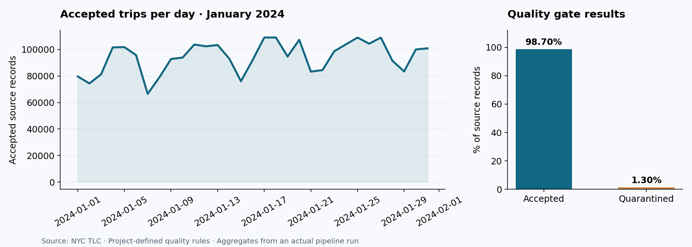
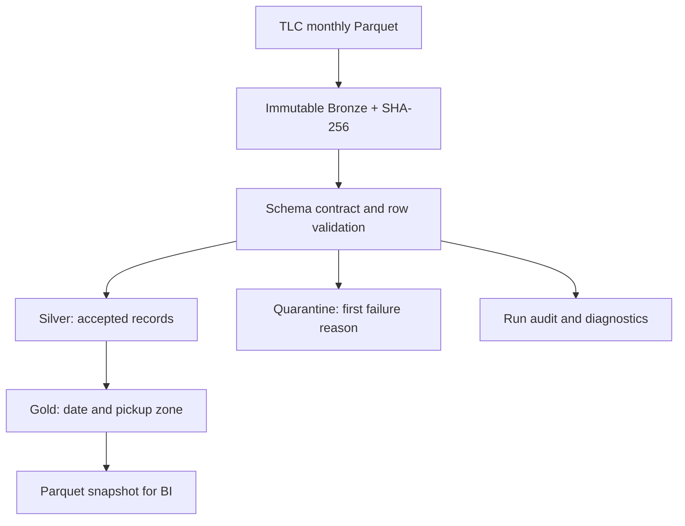

<div align="center">

# NYC Mobility Data Platform

**Reproducible batch analytics over millions of NYC taxi records.**
Immutable source snapshots · Data quality gates · Transactional publication · Offline tests

[](https://github.com/NeilBorjasRamos/nyc-mobility-data-platform/actions/workflows/ci.yml)


[Español](README.es.md) · [Architecture](docs/ARCHITECTURE.md) · [Data contract](docs/DATA_CONTRACT.md) · [Validation](docs/VALIDATION.md) · [Runbook](docs/RUNBOOK.md)

</div>

## Why this project exists

Monthly source files are easy to download. Publishing trustworthy results when
files are revised, schemas change or a validation step fails is the engineering
problem this project addresses.

The platform converts **NYC TLC Yellow Taxi** monthly snapshots into daily
pickup-zone metrics for an operations analyst. Replaying identical input does
not duplicate trips; revised input replaces its month; failed quality or
reconciliation preserves the previously published data.

**Author:** [Neil Borjas Ramos](https://github.com/NeilBorjasRamos)
**Stack:** Python · SQL · DuckDB · Parquet · pytest · Ruff · uv · GitHub Actions

## Engineering evidence at a glance

| Capability | Implementation | Evidence |
|---|---|---|
| Reproducibility | Locked dependencies, packaged SQL, installed CLI | [uv.lock](uv.lock), wheel smoke test in CI |
| Replay safety | Source SHA + model/policy fingerprint | [Replay and configuration tests](tests/test_pipeline.py) |
| Failure isolation | One warehouse transaction and local writer lock | Rollback and lock tests |
| Explainable quality | Row quarantine and persisted reason counts | [Contract](docs/DATA_CONTRACT.md), [real execution](docs/real_run.json) |
| Monthly corrections | Replace affected month in Silver and Gold | Multi-month revision test |
| External consumption | Atomic Parquet snapshot replacement | Export regression test |
| Maintainability | Separate ingestion, model, warehouse and orchestration modules | [Architecture](docs/ARCHITECTURE.md), [ADRs](docs/adr/) |

## Results from a real source month

January 2024 was downloaded and processed, then reprocessed with the current model.
These are **observed results**, not generated example numbers.

| Metric | Observed value |
|---|---:|
| Source records | 2,964,624 |
| Accepted records | 2,926,173 |
| Quarantined records | 38,451 (1.30%) |
| Daily pickup-zone aggregates | 6,947 |
| Silver total amount / Gold gross amount | USD 80,302,017.00 / USD 80,302,017.00 |
| Row and money reconciliation | Passed |



The rejection policy belongs to this analytical product. For example, negative
amounts are quarantined although they may represent legitimate refunds.
Gross amount is the recorded total, **not net revenue or profit**.
See [validation and limitations](docs/VALIDATION.md) and the
[machine-readable evidence](docs/real_run.json).

## Try it without downloading data

Requirements: Python 3.11–3.13, Git and [uv](https://docs.astral.sh/uv/).
Use uv 0.13.4 (the version used for this lock and CI), or a compatible newer release.
Run from the repository root:

```bash
git clone https://github.com/NeilBorjasRamos/nyc-mobility-data-platform.git
cd nyc-mobility-data-platform
uv sync --frozen --extra dev
uv run --frozen taxi --root data_demo demo
uv run --frozen taxi --root data_demo status
uv run --frozen taxi --root data_demo verify
```

The demo creates **20 explicitly synthetic rows**: 19 accepted, 1 quarantined.
It needs no source-network access after dependency installation. It uses a separate
root to avoid replacing a real January publication.

Prefer standard Python packaging? See the
[installation walkthrough](docs/GUIA_COMPLETA.md), including Mac and Windows steps.

## Run a real monthly pipeline

Start with one month. Suggested laptop budget: 8 GB RAM and 10 GB free disk for
experiments; these are planning estimates, not benchmark requirements.
The engine defaults to a 2 GB memory limit and two threads.

```bash
uv run --frozen taxi run --month 2024-01
uv run --frozen taxi status
uv run --frozen taxi verify
uv run --frozen taxi export
```

The source is acquired from the public TLC download host.
An existing source SHA and processing fingerprint returns status=skipped.
A revised source or changed policy/model is processed automatically.

```bash
# Sequential inclusive backfill; restart safely after fixing a failure.
uv run --frozen taxi backfill --start 2024-01 --end 2024-03

# Explicitly rebuild a matching publication.
uv run --frozen taxi run --month 2024-01 --force

# Trusted local source, with the same validation and publication behavior.
uv run --frozen taxi run --month 2024-01 --input /path/to/source.parquet
```

Global --root belongs before the subcommand.
stdout is machine-readable JSON; logs go to stderr; failures exit nonzero.

## Architecture and data lifecycle



- **Bronze:** original bytes, versioned by month and content hash.
- **Silver:** explicitly projected and typed records with source-file provenance.
- **Quarantine:** rejected rows with the first matching quality reason.
- **Gold:** daily demand, gross amount, ticket, distance and duration.
- **Control:** publication manifests, configuration fingerprint, structured audit and lock.

Silver, quarantine, the affected Gold month, manifest and success audit commit
together in DuckDB. Exported Parquet is a separate consumer snapshot.
[Read the transaction boundaries and tradeoffs](docs/ARCHITECTURE.md).

## Query the published data

```python
import duckdb

with duckdb.connect("data/warehouse.duckdb", read_only=True) as con:
    top_zones = con.execute("""
        SELECT pickup_zone_id,
               sum(trips) AS trips,
               sum(gross_amount) / nullif(sum(trips), 0) AS weighted_ticket_usd
        FROM gold_daily_zone
        GROUP BY 1
        ORDER BY trips DESC
        LIMIT 10
    """).fetchall()
    print(top_zones)
```

Use data/gold/daily_zone.parquet for a separate BI process. Avoid simultaneous
cross-process reading while DuckDB is writing. More queries:
[examples/analytics.sql](examples/analytics.sql).

## Quality, testing and delivery

```bash
uv run --frozen ruff check src tests examples scripts
uv run --frozen ruff format --check src tests examples scripts
uv run --frozen pytest --cov --cov-fail-under=80 -q
uv build
```

Local validation on Python 3.12: **28 tests passed, 93% statement coverage**.
CI is configured for Python 3.11, 3.12 and 3.13, plus a clean installed-wheel
demo that checks SQL resources are packaged correctly. Local evidence does not
claim a remote CI run has already passed; the live badge shows GitHub's status.

Tests include source replay, identical legitimate records, quality gates, schema
changes, HTTP failures, corrupted Bronze, multi-month corrections, rollback,
writer exclusion, CLI behavior and snapshot export.

Docker alternative:

```bash
docker build -t nyc-mobility .
docker volume create nyc-mobility-data
docker run --rm -v nyc-mobility-data:/app/data nyc-mobility demo
```

The container runs as a non-root user. Named volumes avoid common bind-mount
ownership issues. Docker has not been executed in the authoring environment.

## Repository map and documentation

| Path | Purpose |
|---|---|
| src/taxi_lakehouse/ | Installable modular package and SQL |
| tests/ | Offline behavioral regression tests |
| examples/analytics.sql | Consumer queries |
| scripts/generate_evidence.py | Rebuild aggregate evidence and figure from real data |
| [docs/GUIA_COMPLETA.md](docs/GUIA_COMPLETA.md) | Step-by-step Spanish walkthrough |
| [docs/ARCHITECTURE.md](docs/ARCHITECTURE.md) | Components, consistency and storage boundaries |
| [docs/DATA_CONTRACT.md](docs/DATA_CONTRACT.md) | Rules, grain, types and metrics |
| [docs/RUNBOOK.md](docs/RUNBOOK.md) | Failures, replay and backup/restore |
| [docs/adr/](docs/adr/) | Architectural decisions and consequences |
| [docs/VALIDATION.md](docs/VALIDATION.md) | Real execution, test evidence and limits |
| [docs/ROADMAP.md](docs/ROADMAP.md) | Explicitly unimplemented next steps |
| [CONTRIBUTING.md](CONTRIBUTING.md) | Development and review workflow |
| [SECURITY.md](SECURITY.md) | Safe reporting and trust boundaries |

## Scope and tradeoffs

This release is a **local data lake plus analytical warehouse**. It does not
implement distributed table formats, Spark, Azure deployment, a scheduler, a
zone-name dimension or a hosted dashboard. The writer lock is local and a crashed
process can leave it behind. Source schema presence and conversions are validated;
physical types are not strictly enforced. These are deliberate documented limits,
with next steps in the roadmap.

No raw datasets, databases, credentials or runtime logs are versioned.
The repository contains aggregate evidence and a generated figure only.

## Source and license

Data: [NYC TLC Trip Record Data](https://www.nyc.gov/site/tlc/about/tlc-trip-record-data.page).
Definitions: [Yellow Taxi data dictionary](https://www.nyc.gov/assets/tlc/downloads/pdf/data_dictionary_trip_records_yellow.pdf).
TLC notes that source accuracy is not guaranteed.
Consult provider terms before redistributing data.

Code: [MIT license](LICENSE). The code license does not license the TLC dataset.
