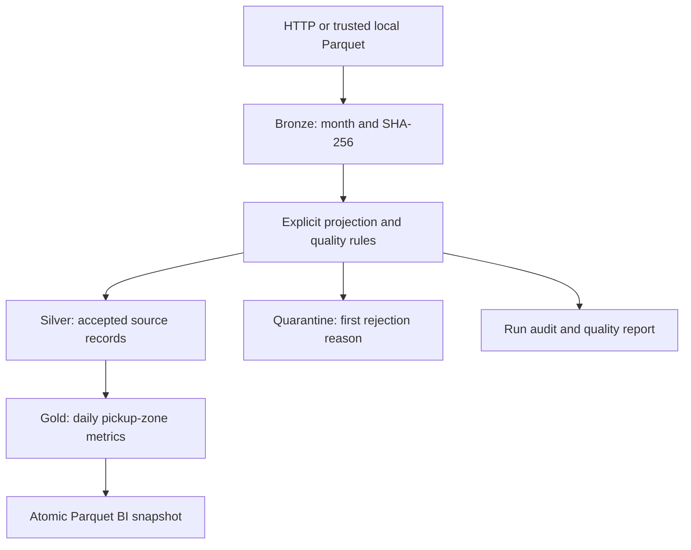

# Architecture
## System boundary
A local batch platform reads complete monthly TLC snapshots. Python orchestrates;
DuckDB owns transactional analytical tables. Source files and exported snapshots
are Parquet. This is a local data lake plus warehouse, not a distributed Delta
or Iceberg implementation.

## Module boundaries
| Module | Responsibility |
|---|---|
| cli | Arguments, JSON stdout, failure exit codes |
| config | Validated policy and processing fingerprint |
| ingest | Stream download, transient retries, immutable Bronze |
| transform | Required columns, explicit casts, row-level classification |
| warehouse | Schema initialization, SQL publication, reconciliation |
| pipeline | Phase orchestration and transaction boundary |
| storage | Local writer lock and atomic JSON replacement |
| demo | Clearly synthetic offline input |

## Publication protocol
1. Acquire an exclusive local writer lock.
2. Acquire source and verify any existing content-addressed file.
3. Compare source SHA and processing fingerprint to the manifest.
4. Stage and classify input; fail before publication if quality gate fails.
5. Begin one DuckDB transaction; replace the month in Silver/quarantine/Gold.
6. Reconcile rows and monetary totals, write manifest and success audit, commit.
7. Write a supplemental JSON report. Its failure cannot invalidate a committed run.

Failures during publication roll back all analytical tables, manifest and success
audit. A failure audit is inserted after rollback. Source files remain available.
A kill -9 can leave a lock and may prevent failure auditing; see the runbook.

## Storage and identity
Bronze: data/bronze/source_month=YYYY-MM/SHA.parquet.
Warehouse: data/warehouse.duckdb.
Diagnostics: data/reports/RUN_ID.json.
Snapshot: data/gold/daily_zone.parquet.

Silver grain is one accepted source record. Provenance is source month, file SHA
and one-based physical Parquet file_row_number. It identifies a record within an
exact file, not a business trip across file revisions. Equal-valued source records
are retained. Gold's primary key is (source_month, service_date, pickup_zone_id).

Manifest paths are relative to the root for new publications. Earlier prototype
absolute paths remain readable but should be reprocessed before moving a backup.
The processing fingerprint includes MODEL_VERSION and reject threshold; resource
budgets are excluded because they do not define business semantics.

## Consistency and limits
The local lock coordinates the project CLI on one host; do not use it on object
storage or as a multi-host coordinator. DuckDB's own file lock also applies.
Read commands must not run in a separate process during a writer session.
The export takes the writer lock and replaces a same-directory temporary file.
It is a separately generated snapshot, outside the warehouse transaction.
Atomic rename is not a promise of durability across power loss on every filesystem.

Silver replacement scans/deletes by source_month. It is not physically partitioned
Parquet. Gold aggregation only recomputes the affected month. Measure before
claiming performance benefits. The current release has no zone dimension, remote
orchestrator, dashboard service or production SLA.
